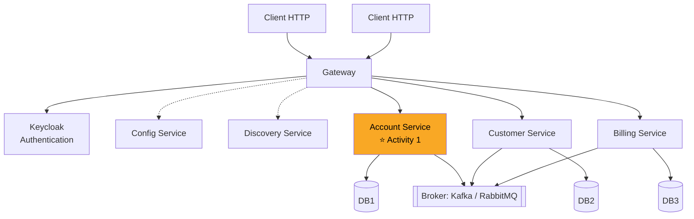

# 00 · Project objectives: what and why

## The objective in one sentence

Build **one microservice** (a bank-account service) the professional way, so that later you can
**combine many of them** into a distributed system, and eventually add AI agents (Spring AI) on top.

Activity 1 is the *unit* of everything that follows: every service in the big architecture
(Inventory, Billing, Customer...) is built with exactly the same recipe you learn here.

## Where Activity 1 sits in the big picture

Activity 1 = the starred box only. Everything else comes in later activities.

## What you should be able to do after Activity 1

1. Create a Spring Boot project and explain what each starter dependency brings.
2. Map a Java class to a database table (JPA entity) and query it without writing SQL (Spring Data).
3. Expose that data as a **REST API** and test it with an HTTP client.
4. Generate **interactive API documentation** (OpenAPI / Swagger UI).
5. Get a REST API *for free* from your repositories (Spring Data REST) and shape its output (projections).
6. Structure code in **layers** (web → service → data) with **DTOs** and **mappers**, the way real teams do.
7. Expose the same data through **GraphQL** and explain when you'd pick it over REST.

## The 11 steps → the concepts behind them

| Step | What you do | Concept you're learning | Notes file |
|---|---|---|---|
| 1 | Create the project | Spring Boot, starters, Maven | 01 |
| 2 | `Compte` entity | ORM / JPA, entities | 02 |
| 3 | `CompteRepository` | Spring Data repositories | 02 |
| 4 | Test the DAO layer | Running code at startup, H2 console | 02 |
| 5 | REST web service | REST, HTTP verbs, `@RestController` | 03 |
| 6 | Test with a REST client | HTTP requests/responses, status codes | 03 |
| 7 | Swagger docs | OpenAPI specification | 03 |
| 8 | Spring Data REST + projections | Auto-generated APIs, HATEOAS | 03 |
| 9 | DTOs and mappers | Separating API model from DB model | 04 |
| 10 | Service layer | Business logic, transactions | 04 |
| 11 | GraphQL | Client-shaped queries, schemas | 05 |

## Why these technologies (and not others)

| Technology | Why it's here |
|---|---|
| **Java 21** | Current long-term-support Java; the language of the Spring ecosystem. |
| **Spring Boot 3.5** | Removes boilerplate: embedded server, auto-configuration, sensible defaults. 3.5 (not 4) because the required springdoc 2.8.13 targets it. |
| **Maven** | Downloads libraries and builds the app reproducibly from one file (`pom.xml`). |
| **Spring Data JPA** | Talk to a database with Java objects and interfaces instead of SQL boilerplate. |
| **H2** | In-memory database: zero install, perfect for learning and tests. Swapped for MySQL/PostgreSQL later without code changes. |
| **Lombok** | Generates getters/setters/constructors/builders so classes stay readable. |
| **springdoc-openapi** | Documents the API automatically and gives a web page to try it. |
| **Spring Data REST** | Shows how much can be generated, and its limits (why we still write controllers). |
| **ModelMapper / MapStruct** | Copies data between entities and DTOs. |
| **Spring for GraphQL** | Second way to expose the same service; teaches API design trade-offs. |

## My notes

