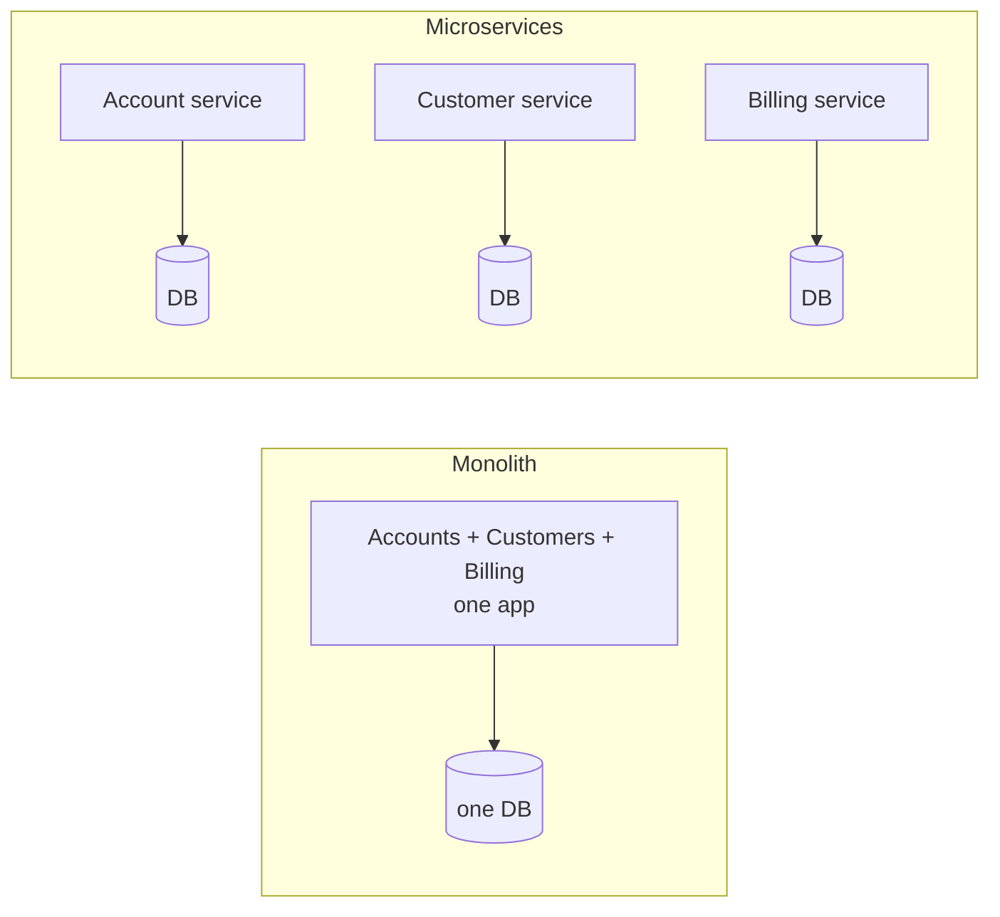
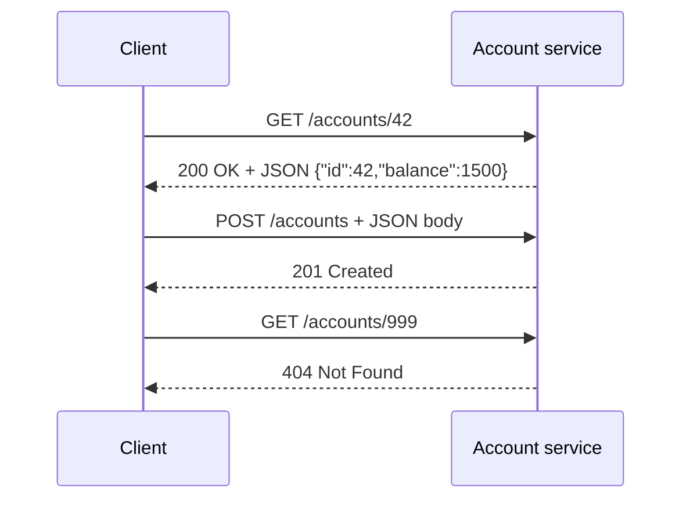
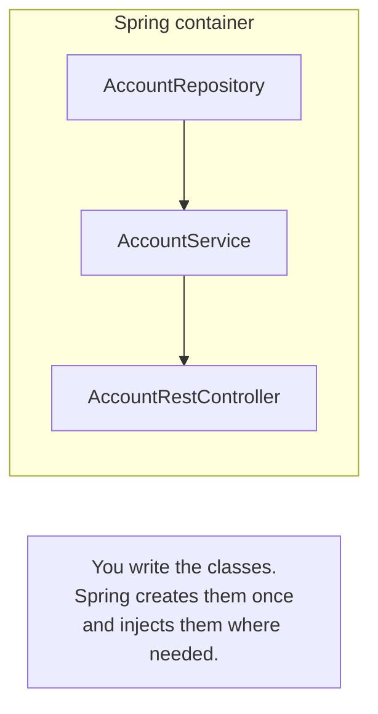

# 01 · Foundations (read before step 1)

## Monolith vs microservices

A **monolith** is one application containing every feature, with one database. A **microservice
architecture** splits features into small, independent applications, each owning its data.



| | Monolith | Microservices |
|---|---|---|
| Deploy | all at once | each service on its own |
| Scale | the whole app | only the busy service |
| A bug crashes... | everything | usually one service |
| Complexity | in the code | in the network (discovery, config, security, messaging) |

That last row is why the later activities exist: microservices move complexity *into the
infrastructure*, and the Gateway / Discovery / Config / Keycloak / broker boxes are the answers.

## HTTP and REST in 60 seconds

Services talk over **HTTP**: a client sends a *request*, the server returns a *response*.



**REST** is a style for designing those HTTP APIs:
- **Resources** are nouns in the URL: `/accounts`, `/accounts/42`.
- **HTTP verbs** are the actions:

| Verb | Meaning | Example |
|---|---|---|
| `GET` | read | `GET /accounts` |
| `POST` | create | `POST /accounts` |
| `PUT` | replace / update | `PUT /accounts/42` |
| `DELETE` | delete | `DELETE /accounts/42` |

- **Status codes** say how it went: `2xx` success, `4xx` client's fault (bad input, not found),
  `5xx` server's fault.
- Data travels as **JSON**.

## Spring Boot

**Spring** is a framework that manages your application's objects for you. **Spring Boot** is
Spring with batteries included:
- an **embedded web server** (Tomcat): your app is a plain `java -jar`, no server to install;
- **auto-configuration**: add H2 to the classpath and Boot configures a datasource for you;
- **starters**: one dependency (`spring-boot-starter-web`) pulls in a coherent set of libraries.

## IoC and dependency injection (the core idea of Spring)

Without Spring, each class creates what it needs with `new`. With Spring, you **declare** what
you need and the **container** creates and wires the objects: *Inversion of Control*.



```java
@Service                       // "Spring, please manage this class"
public class AccountService {
    private final AccountRepository repository;
    public AccountService(AccountRepository repository) {   // Spring passes it in
        this.repository = repository;
    }
}
```

Objects managed by Spring are called **beans**. Annotations like `@Service`, `@RestController`,
`@Repository`, `@Component` mark classes as beans. Prefer **constructor injection** (above); with
Lombok, `@AllArgsConstructor` or `@RequiredArgsConstructor` writes that constructor for you.

## Maven

`pom.xml` declares your project: its coordinates (groupId/artifactId), Java version, and
**dependencies**. Maven downloads them from Maven Central into `~/.m2` and builds the app.

| Command | Does |
|---|---|
| `./mvnw compile` | compile the code |
| `./mvnw test` | run the tests |
| `./mvnw spring-boot:run` | start the app |
| `./mvnw package` | build the `.jar` in `target/` |

`mvnw` is the *Maven wrapper*: it guarantees everyone uses the same Maven version.

## Project anatomy (what Spring Initializr generates)

```
bank-account-service/
├── pom.xml                        ← dependencies & build
├── mvnw                           ← Maven wrapper
└── src/
    ├── main/
    │   ├── java/.../BankAccountServiceApplication.java   ← main(), starts everything
    │   └── resources/application.properties              ← configuration (port, DB, ...)
    └── test/java/...                                     ← tests
```

## My notes

