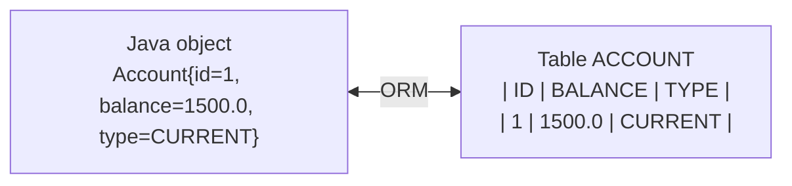
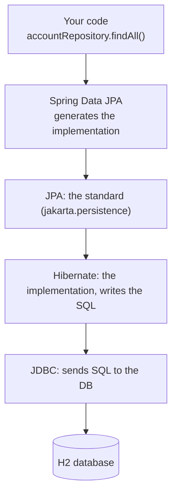
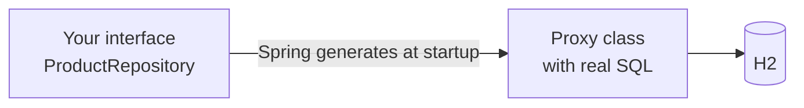

# 02 · The data layer (read before steps 2–4)

## The problem: objects vs tables

Java thinks in **objects**, databases think in **tables**. Converting by hand (JDBC + SQL for
every query) is long and repetitive. An **ORM** (Object-Relational Mapper) does the conversion.



## The stack, from your code down to the database



You only touch the top two levels; the rest is configured automatically by Spring Boot.

## JPA entity = a class mapped to a table

```java
@Entity                                   // this class is a table
public class Product {
    @Id                                   // primary key
    @GeneratedValue(strategy = GenerationType.IDENTITY)  // DB generates the id
    private Long id;
    private String name;                  // → column NAME
    @Enumerated(EnumType.STRING)          // store enums as text, not 0/1/2
    private Category category;
}
```

| Annotation | Purpose |
|---|---|
| `@Entity` | maps the class to a table |
| `@Id` | primary key |
| `@GeneratedValue` | who generates the id (DB auto-increment, or a sequence) |
| `@Column` | customise a column (name, nullable, length) |
| `@Enumerated(EnumType.STRING)` | store an enum by its name; safer than by position |
| `@Temporal` / `java.time` types | dates (with `LocalDate`, no annotation needed) |

Question to keep in mind for step 2: should the id be a `Long` or a `String` (e.g. a UUID)?
Both are valid; we'll discuss the trade-off when you write `Compte`.

## Lombok: less boilerplate

| Annotation | Generates |
|---|---|
| `@Getter` / `@Setter` | getters / setters |
| `@Data` | getters, setters, `toString`, `equals`, `hashCode` |
| `@NoArgsConstructor` | empty constructor (**JPA requires one**) |
| `@AllArgsConstructor` | constructor with every field |
| `@Builder` | fluent creation: `Product.builder().name("x").build()` |

Caution: `@Data` on entities with relationships can cause infinite `toString` loops. Fine for
our simple entity; remember it later.

## Spring Data repository: queries without implementation

You write an **interface**; Spring generates the class at startup.

```java
public interface ProductRepository extends JpaRepository<Product, Long> { }
//                                                        ^entity  ^id type
```

That one line gives you `save`, `findById`, `findAll`, `deleteById`, `count`, paging, sorting...

You can add queries just by **naming methods**:

```java
List<Product> findByCategory(Category category);          // WHERE category = ?
boolean existsByName(String name);                         // used for "already exists" checks
```



## H2: an in-memory database

- Runs inside your app: nothing to install, wiped at each restart (in memory mode).
- Has a web console to look at the tables. In `application.properties`:

```properties
spring.h2.console.enabled=true
spring.datasource.url=jdbc:h2:mem:bank
```

  Then open `/h2-console` on the app's port (in Codespaces: **Ports** tab → globe icon for 8080).
- `spring.jpa.show-sql=true` prints the SQL Hibernate writes: very instructive.

## Testing the DAO layer (step 4)

"DAO" (Data Access Object) = the data layer, i.e. your repository. Two common ways to test it:

1. **At startup:** a `CommandLineRunner` bean runs once the app starts; insert a few rows and
   print them. Quick and visual: this is what the course video does.
2. **As a real test:** a test class annotated `@DataJpaTest` boots only the JPA layer with H2
   and lets you assert results. Slower to write, but it runs automatically with `./mvnw test`.

We'll start with (1) and you can add (2) as a bonus.

## My notes

