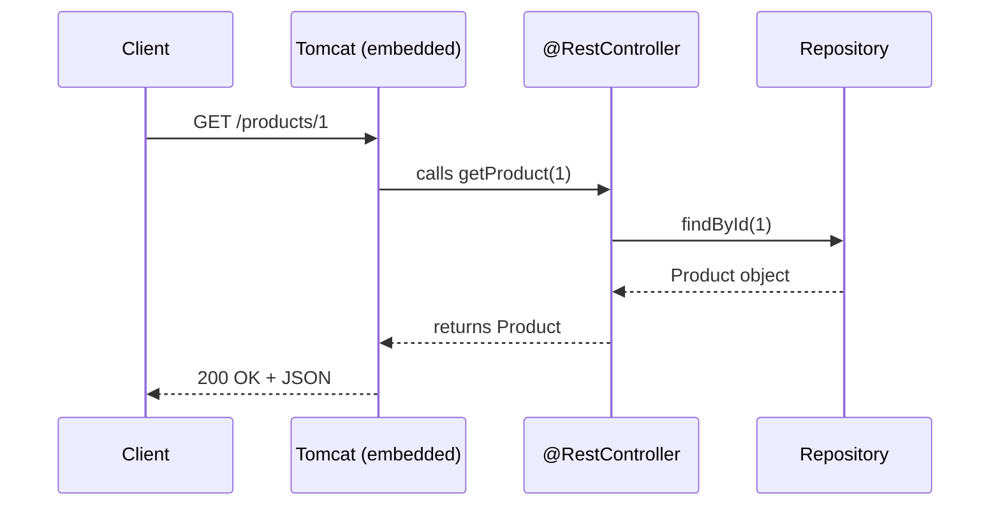
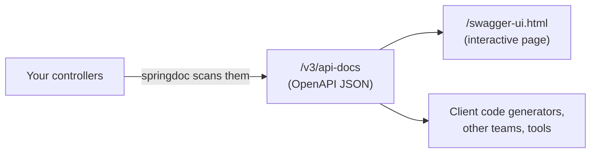

# 03 · The web layer (read before steps 5–8)

## REST controller: HTTP in, Java out

A controller maps URLs + HTTP verbs to Java methods. Spring converts Java objects to/from JSON
automatically (with the Jackson library).



```java
@RestController
@RequestMapping("/api")
public class ProductRestController {
    private final ProductRepository repository;
    // constructor injection omitted

    @GetMapping("/products")                      // GET /api/products
    public List<Product> all() { return repository.findAll(); }

    @GetMapping("/products/{id}")                 // GET /api/products/1
    public Product one(@PathVariable Long id) {
        return repository.findById(id).orElseThrow();
    }

    @PostMapping("/products")                     // POST /api/products  (JSON body)
    public Product create(@RequestBody Product p) { return repository.save(p); }
}
```

| Annotation | Purpose |
|---|---|
| `@RestController` | this class answers HTTP requests with data (JSON) |
| `@RequestMapping("/api")` | common URL prefix |
| `@GetMapping` `@PostMapping` `@PutMapping` `@DeleteMapping` | verb + path |
| `@PathVariable` | value taken from the URL (`/products/{id}`) |
| `@RequestBody` | JSON body → Java object |
| `@RequestParam` | query string (`?page=2`) |

## Testing with a REST client (step 6)

The assignment mentions **Postman**. Inside the Codespace you also have the **REST Client**
extension: write requests in a `.http` file and click *Send Request*:

```http
### list
GET http://localhost:8080/api/products

### create
POST http://localhost:8080/api/products
Content-Type: application/json

{ "name": "Laptop", "category": "TECH" }
```

`localhost` works from inside the Codespace. From Postman on your own PC, use the forwarded URL
from the **Ports** tab, and set the port's visibility to *Public* or sign in, since it's private
by default.

## OpenAPI / Swagger (step 7)

**OpenAPI** is a standard JSON/YAML description of an API: its endpoints, parameters, schemas.
**Swagger UI** is a web page that reads that description and lets you try each endpoint.



With the `springdoc-openapi-starter-webmvc-ui` dependency there's nothing to code: start the app
and open `/swagger-ui.html`. Why it matters in microservices: each team publishes its contract,
and other services and front-ends code against it.

## Spring Data REST + projections (step 8)

Spring Data REST exposes your **repositories directly** as REST endpoints, with no controller:

```java
@RepositoryRestResource
public interface ProductRepository extends JpaRepository<Product, Long> { }
// → GET/POST /products, GET/PUT/DELETE /products/{id}, paging, sorting... for free
```

Responses follow **HAL** format (JSON with `_links`, part of the *HATEOAS* idea: responses
tell the client where it can go next).

A **projection** chooses which fields to return, without changing the entity:

```java
@Projection(name = "summary", types = Product.class)
public interface ProductSummary {
    String getName();          // only the name...
    Category getCategory();    // ...and the category
}
// GET /products?projection=summary
```

**When to use it:** quick admin APIs, prototypes. **Limits:** your database model *is* your API
(no business rules, no DTOs), which is exactly why steps 9–10 add proper layers.

## My notes

