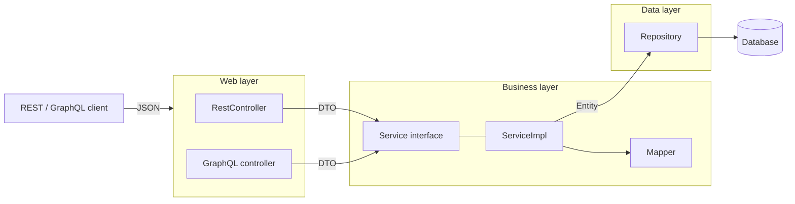
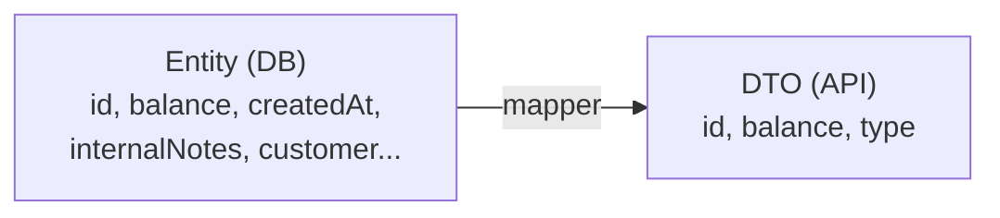
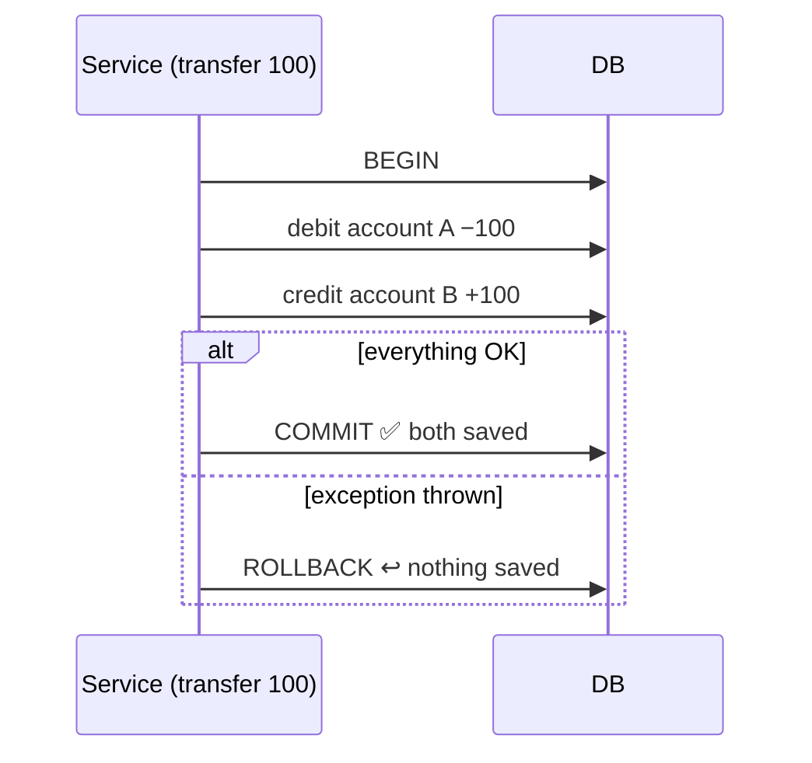

# 04 · Layered architecture: DTOs, mappers, services (read before steps 9–10)

## The target structure (from the course slide)



Each layer has **one job** and only talks to the layer below it:

| Layer | Job | Knows about |
|---|---|---|
| Web | HTTP / GraphQL in and out, input validation | DTOs |
| Service | business rules (e.g. "email already used", "insufficient balance") | DTOs + entities |
| Data | storage | entities |

Why: you can change one layer (e.g. add GraphQL next to REST) without touching the others, and
test business rules without HTTP.

## DTO: Data Transfer Object

A **DTO** is a plain class shaped for the **API**, separate from the **entity** shaped for the
**database**.



Why not just return the entity?
- **Security:** you don't leak internal fields.
- **Stability:** you can change the table without breaking clients.
- **Fit:** request DTO (what the client sends) and response DTO (what it receives) can differ,
  e.g. a request never contains the `id`.
- **No JPA surprises:** lazy-loading errors and JSON loops stay inside the service layer.

## Mapper

The mapper converts entity ⇄ DTO. Three options:

| Option | How | Trade-off |
|---|---|---|
| By hand | `dto.setName(entity.getName())`... | explicit, verbose |
| **ModelMapper** (course slide) | `modelMapper.map(entity, Dto.class)` matches fields by name at runtime | quick; mistakes only show at runtime |
| MapStruct | generates mapping code at compile time | fast and type-safe; a bit more setup |

We'll follow the slide (ModelMapper) unless you want to try MapStruct.

## Service layer

```java
public interface AccountService {               // the contract
    AccountResponseDTO addAccount(AccountRequestDTO request);
}

@Service @Transactional
public class AccountServiceImpl implements AccountService {   // the implementation
    // business rules live here, then repository + mapper calls
}
```

Why an interface plus an implementation? Controllers depend on the contract, not the class, so
you can swap or mock the implementation in tests.

## Transactions (`@Transactional`)

A **transaction** groups database operations into **all-or-nothing**.



Put `@Transactional` on the service: each public method becomes one transaction.

## Business exceptions

The slide's `EmailAlreadyUsedException` shows the pattern: the **service** detects a rule
violation and throws a named exception. The **web layer** later translates it into an HTTP
error (e.g. `409 Conflict` or `400 Bad Request`) instead of a generic `500`.

## My notes

