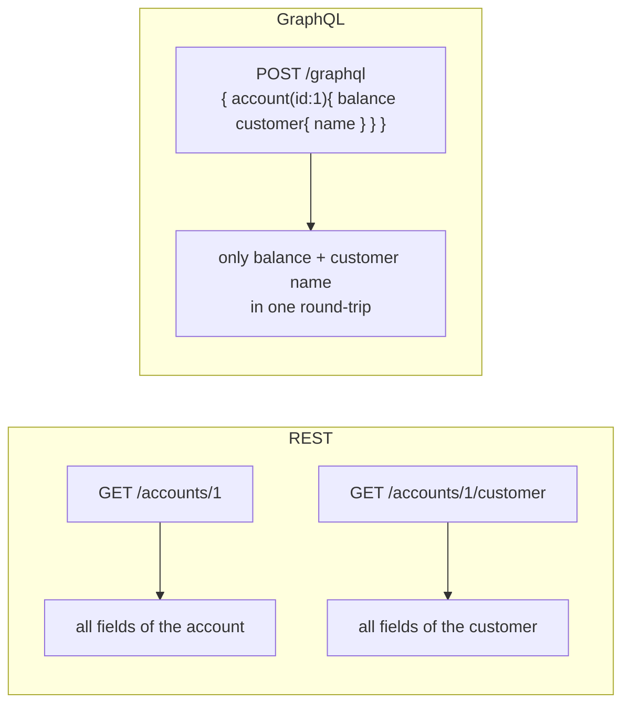

# 05 · GraphQL (read before step 11)

## The idea

With REST, the **server** decides the shape of each endpoint's response. With **GraphQL**, there
is **one endpoint** (`/graphql`) and the **client** writes a query describing exactly the fields
it wants.



| | REST | GraphQL |
|---|---|---|
| Endpoints | many (one per resource) | one |
| Response shape | fixed by the server | chosen by the client |
| Over/under-fetching | common | avoided |
| Caching with HTTP | easy | harder |
| Best for | simple, cacheable public APIs | front-ends needing varied, nested data |

## The schema: the contract

GraphQL is **strongly typed**. You describe types and operations in a `.graphqls` file
(in Spring: `src/main/resources/graphql/`):

```graphql
type Query {                                  # reads
  products: [Product]
  productById(id: ID!): Product               # ! = required
}

type Mutation {                               # writes
  addProduct(product: ProductInput): Product
}

type Product { id: ID, name: String, category: String }
input ProductInput { name: String, category: String }   # "input" = what the client sends
```

## Spring for GraphQL: wiring the schema to Java

```java
@Controller
public class ProductGraphQLController {
    @QueryMapping                                   // matches Query.products
    public List<ProductDTO> products() { ... }

    @QueryMapping                                   // matches Query.productById
    public ProductDTO productById(@Argument Long id) { ... }

    @MutationMapping                                // matches Mutation.addProduct
    public ProductDTO addProduct(@Argument ProductInput product) { ... }
}
```

Method names match the schema's field names. Notice that the controller calls the **same
service** as the REST controller: that's the payoff of the layered architecture.

## Trying it

Enable the built-in playground in `application.properties`:

```properties
spring.graphql.graphiql.enabled=true
```

Then open `/graphiql` on the app's port and run:

```graphql
query { products { name } }
```

## My notes

