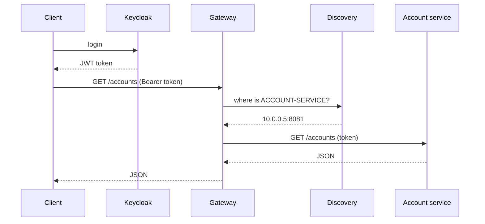

# 06 · The bigger picture (for later activities)

Short versions only, to know *why* each box exists. Each one gets its own notes file when we
reach it.

| Component | Problem it solves | Typical tool |
|---|---|---|
| **Gateway** | Clients shouldn't know every service's address; one entry point routes requests, and handles cross-cutting concerns (security, CORS, rate limits). | Spring Cloud Gateway |
| **Discovery service** | Services start, stop and move; each registers itself so others can find it by **name** instead of IP:port. | Eureka (Spring Cloud Netflix) |
| **Config service** | Many services × many environments = scattered config; centralise it (often in a Git repo). | Spring Cloud Config |
| **Authentication** | Log users in once, issue tokens (JWT) that every service can verify. | Keycloak (OAuth2 / OpenID Connect) |
| **Service-to-service calls** | Calling another service's REST API cleanly, by name. | OpenFeign |
| **Resilience** | One slow service shouldn't take everything down (timeouts, retries, fallback). | Resilience4j (circuit breaker) |
| **Message broker** | Asynchronous events ("account created") instead of direct calls; services stay decoupled. | Kafka, RabbitMQ |
| **One DB per service** | Services own their data, so they can evolve and scale independently. | H2 → MySQL / PostgreSQL |
| **Containers** | Run all of the above the same way everywhere. | Docker, Docker Compose |

## How a request flows in the full system

## Where agents (Spring AI) fit

Spring AI lets a service call an LLM and give it **tools**: ordinary Java methods, often the very
service methods you write in Activity 1. An "agentic" microservice can then answer *"what's the
total balance of my savings accounts?"* by choosing and calling those tools itself. The clean
service layer you build now is what makes that possible later.

## My notes

